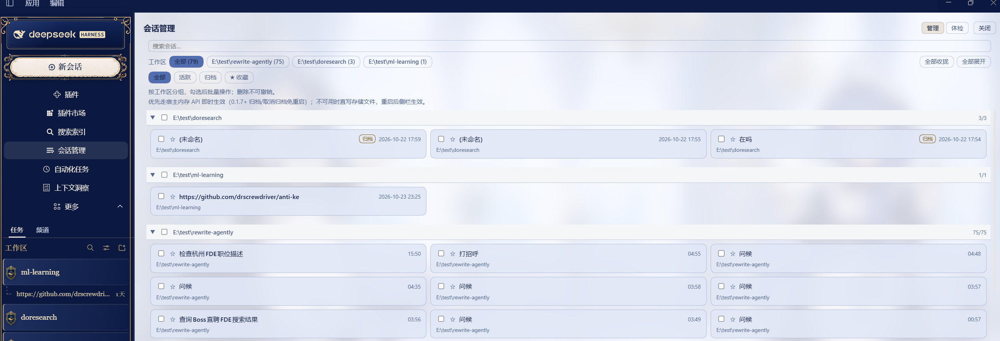
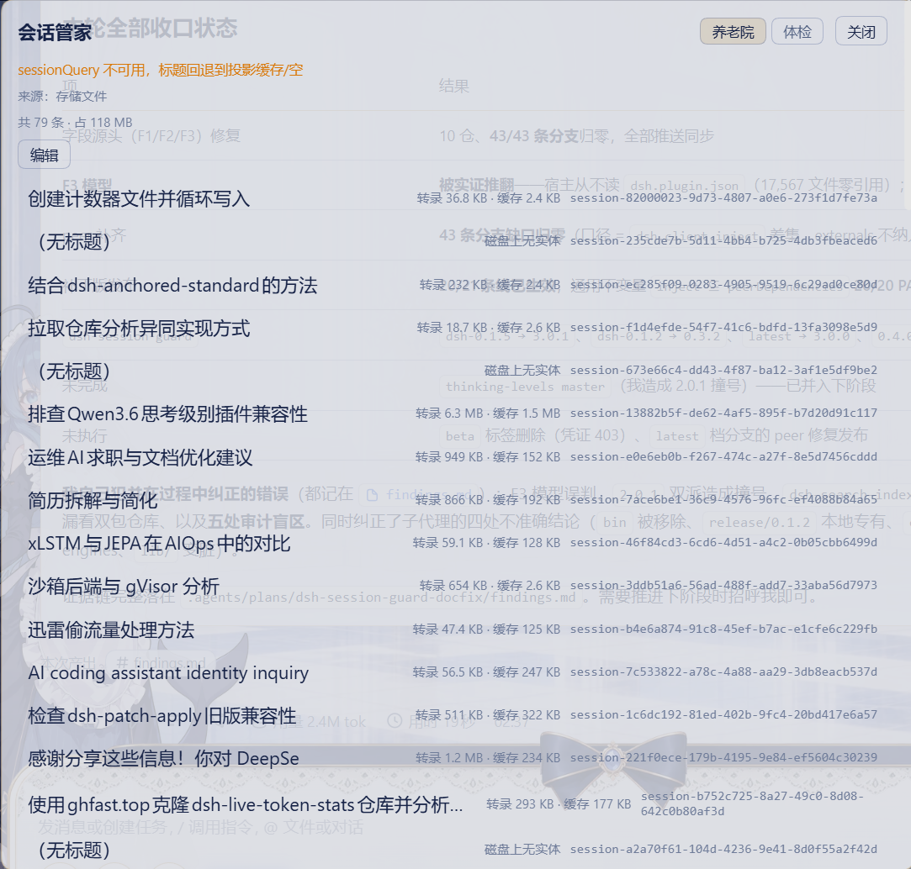

<div align="center">

# dsh-manage-session

**Consola de sesiones · archivo y papelera — sesiones activas y archivadas en un solo lugar**

[简体中文](README.md) · [English](README.en.md) · [日本語](README.ja.md) · [한국어](README.ko.md) · [Français](README.fr.md) · [Deutsch](README.de.md) · [Italiano](README.it.md) · [Русский](README.ru.md) · **Español** · [Português](README.pt.md)

[](https://www.npmjs.com/package/dsh-manage-session)
[](https://www.npmjs.com/package/dsh-manage-session)
[](LICENSE)
[](https://github.com/drscrewdriver/dsh-manage-session)
[](https://github.com/drscrewdriver/dsh-manage-session)

</div>

> Plugin DeepSeek Harness (DSH) mantenido por la comunidad, no es un producto oficial de DeepSeek AI.

Este documento describe **2.0.16**. Cambios publicados en el [registro](CHANGELOG.md).

## Funcionalidad

Guarda las sesiones que no necesitas en el archivo y recupéralas cuando quieras; borrar pasa por una papelera, nunca por un borrado irreversible.

- **Vista de sesiones archivadas**: el ámbito «Archivadas» del panel lista todas las sesiones archivadas, agrupadas y contadas por espacio de trabajo.
- **Búsqueda por espacio de trabajo**: chips de espacio, prefijo `workspace:` y filtro por título/ruta para manejar decenas de proyectos.
- **Restaurar y borrar**: restaurar = desarchivar (vuelve a la barra lateral); borrar = archivar → papelera → quitar el uuid, reversible.
- **Papelera y compactación periódica**: `trash` mueve a `~/.dsh/trash/manage-session/<lote>/`, `compact` fusiona lotes por día/semana/mes en `.tar.zst`, `restore` los devuelve.
- **Favoritos y acciones por lotes**: estrella, vista «solo favoritos», archivar y borrar por lotes (doble confirmación).
- **Primera pintura instantánea + chequeo de salud de cuatro puertas**: títulos sin I/O y relleno por flujo de tramas (373 ms con 252 sesiones); integridad de logs, caché de proyección, JSON sin pérdidas, cierre en lectura fría.

## Capturas






## Instalación

**Host compatible**: `engines.dsh` es `>=0.1.0-rc.2 <0.3.0-0`; las líneas `0.1.x` y `0.2.x` están verificadas.

### Deja que un agente lo instale (recomendado)

```text
Instala la última versión de dsh-manage-session en el perfil de DSH que uso, desde el registro npm oficial, y confirma la versión e indícame cómo recargar.
```

### Instalación / actualización manual

```powershell
[Console]::OutputEncoding = [System.Text.Encoding]::UTF8
$OutputEncoding = [System.Text.Encoding]::UTF8

dsh plugin --profile web add dsh-manage-session@latest --registry=https://registry.npmjs.org/
```

Reinicia DSH después (los plugins del host se cargan al arrancar) y refresca la interfaz para ver la entrada «Gestión de sesiones».

## Configuración

Espacio de ajustes `manage-session`:

- `enabled` (`true`) — Interruptor general; apagado, el panel y todas las rutas fenced no se registran
- `historyFiles` (`true`) — Rutas de escritura archivar / desarchivar / borrar (papelera)
- `healthCheck` (`true`) — Chequeo de salud de cuatro puertas y recetas de reparación
- `directDelete` (`false`) — Mostrar o no la fila «Borrar» en el menú de sesión (apagado por defecto)

**Posición de la entrada**: ranura de herramientas superior de la barra lateral si existe, si no el pie.

## Uso

- **Archivar una sesión** — Selecciona y pulsa «Archivar»; desaparece de la barra lateral al instante. Las sesiones activas se detienen antes.
- **Restaurar una sesión** — Selecciona en «Archivadas» y pulsa «Desarchivar»; vuelve a su espacio.
- **Borrar una sesión** — Dos clics en «Borrar»; va a la papelera y su uuid sale del registro al instante.
- **Buscar un espacio** — Pulsa un chip o escribe `workspace:palabra` en la búsqueda.
- **Favoritos** — Pulsa la estrella; activa «solo favoritos» en el menú de vista.

## Archivo, borrado y limpieza (script determinista)

Para una limpieza completa ejecuta el script con el host cerrado; nunca hace `rm` directo de los datos de sesión:

```bash
node node_modules/dsh-manage-session/scripts/session-purge.mjs list
node node_modules/dsh-manage-session/scripts/session-purge.mjs trash --class empty-session --archive-first
node node_modules/dsh-manage-session/scripts/session-purge.mjs compact --older-than 7 --window week
node node_modules/dsh-manage-session/scripts/session-purge.mjs restore --archive <period> [--ids <id,...>]
node node_modules/dsh-manage-session/scripts/session-purge.mjs ledger
```

- `list` clasifica en solo lectura: `orphan-id` (en registro, ausente en disco) / `empty-session` / `untitled-session` / `encoded-id` / `ok`.
- `trash` mueve a la papelera y limpia el registro; `compact --window week` fusiona lotes por período y vacía las carpetas restaurables directamente.
- `restore --archive <período> [--ids ...]` restaura; `ledger` es el registro append-only de cada limpieza.
- **Zona de lápidas**: `tombstones` solo muestra borrados incompletos (`pending-cleanup`); `forget` elimina las entradas cuya entidad ya no existe.

## Almacenamiento y rutas

Los archivos del host se respaldan antes de escribir; sin índice propio de sesiones, la búsqueda la aporta `dsh-search-index`.

- `~/.dsh/storages/workspace.json` — Conjunto archivado y pertenencia a espacios (archivo del host)
- `~/.dsh/storages/manage-session/purge-ledger.jsonl` — Registro de limpieza (append-only, un uuid por línea)
- `~/.dsh/trash/manage-session/` — Papelera: carpetas de lote + `archive/*.tar.zst`

```text
session-catalog            session-catalog-stream
session-history-list       session-history-archive
session-history-prune      session-history-purge
session-history-favorites-list / session-history-favorite-set

session-health-status      session-health-scan
session-health-session     session-health-repair
session-health-source-migrate

settings-describe          settings-mutate
```

## Avisos

- El borrado sigue siendo definitivo: la papelera restaura todo, pero tras `compact` se restaura desde `.tar.zst`; destruir un lote exige `--yes`.
- «Sin título» no es residuo de borrado: las sesiones sin mensajes y las de id codificado `im:` simplemente no tienen título.
- Con un proceso del host vivo, el script rechaza `trash/compact/restore` (`--allow-running` lo fuerza).

## Preguntas frecuentes

### ¿No aparece la entrada tras instalar?

Reinicia DSH; comprueba que esté en el perfil que usas y que `cordis.patch.yml` no desactive `dsh-manage-session`.

### ¿Archivar o borrar?

Archivar solo aparta y se deshace; borrar pasa por la papelera, quita el registro y sigue siendo restaurable desde el archivo.

### ¿Convive con otros plugins de archivo?

Sí. El conjunto archivado es estado compartido del host: ambos leen los mismos datos con entradas separadas.

## Licencia

Distribuido bajo [MIT License](LICENSE).

<details>
<summary>Build from source</summary>

```powershell
git clone https://github.com/drscrewdriver/dsh-manage-session.git
Set-Location .\dsh-manage-session
pnpm install --frozen-lockfile
npm run build
dsh plugin --profile web add .
```

</details>

