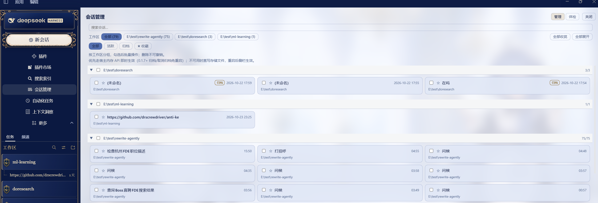
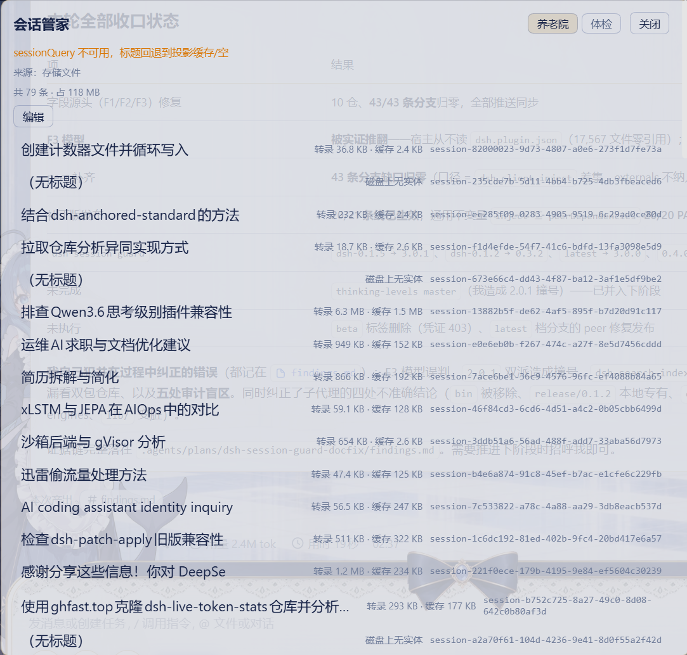

# dsh-manage-session（セッションマネージャー）

> **旧名**：`dsh-session-steward`（セッション・スチュワード）。2.0.0 で `dsh-manage-session` に改名し、
> 検索／索引は [`dsh-search-index`](https://github.com/drscrewdriver/dsh-search-index) に戻しました。

DSH Web プラグイン：**アクティブ／アーカイブ済みセッションの統合管理台＋セッション健診**。

- **管理（メインページ）** — ワークスペース別に活性＋アーカイブのセッションを一覧。ドメイン
  フィルタ（すべて／アクティブ／アーカイブ）、タイトル絞り込み、お気に入り、一括のアーカイブ／
  解除／実体削除（不可逆）。
- **健診（補助タブ）** — 四つのゲート → 処方 → 退院（可逆な処置）。

> **検索・索引は本パッケージに含まず、DRS 依存もありません**：検索は `dsh-search-index` が担当。
> 管理台の語料はホストの `sessionQuery` と公式アーカイブ集合から `session-catalog` が組み立てます。

## 入口の位置（上部ツール枠 / 下部フォールバック）

| ホストの能力 | 入口の形 |
|---|---|
| 上部ツール行（`sidebar.panellist` + `main`）を宣言 | 「プラグイン」の直後、「その他」の手前（order 6）に**パネル行**。クリックでメイン列に全ページ表示 |
| 枠が無いホスト | サイドバー下部（`sidebar.footer.action`）にフォールバックし、ダイアログを開く |

<!-- hosts-sync:begin -->
<!-- Generated by scripts/sync-hosts.mjs; single source in scripts/hosts.mjs -->
Supports DSH 0.1.0-rc.2, 0.1.0-rc.3, 0.1.0-rc.6, 0.1.0-rc.7, 0.1.0-rc.8, 0.1.1-rc.1, 0.1.1-rc.2, 0.1.2-rc.1, 0.1.5-rc.1, 0.1.5-rc.2, 0.1.5-rc.3, 0.1.7-rc.1, 0.1.7-rc.2, 0.2.0-rc.1, 0.2.0-rc.2, 0.2.1-rc.1, 0.2.1-rc.2, 0.2.1-rc.3 (enumerated peers — a per-rc tested whitelist; alpha/beta releases are out of scope).
<!-- hosts-sync:end -->

## スクリーンショット

**現在の形** —— 入口はサイドバー上部のツール行（「プラグイン」の後、「その他」の前）。開くとセッション管理台：
ワークスペース別の 3 列カード、ワークスペース／検索域（すべて・アクティブ・アーカイブ）の絞り込み、お気に入り、
選択行の一括アーカイブ・解除・整理（不可逆な操作は 2 回確認）：



**過去の形**（沿革の参照用。現行 UI ではありません）：

| 統合パッケージ期（1.x：検索同梱・2 タブダイアログ・終了） | さらに以前（≤0.5.7：入口はサイドバー下部） |
|---|---|
|  |  |

## インストール／設定／開発

```bash
dsh plugin --profile web add dsh-manage-session   # インストール後に再起動
pnpm install && pnpm typecheck && pnpm test && pnpm build
```

設定名前空間 `manage-session`：`enabled`、`historyFiles`、`healthCheck`、`directDelete`。

## ライセンス

MIT
